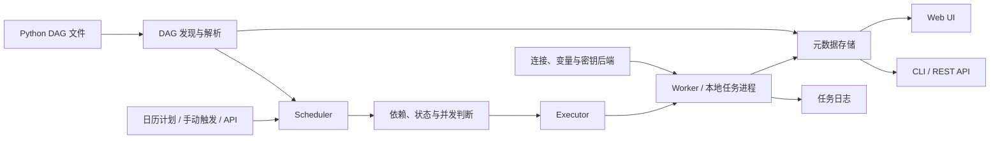

# Apache Airflow · Recipkg 配方

**把 Python DAG、调度器、执行器和任务状态整理成可复核的工作流重建合同。**

[标准库](https://github.com/recipkg/standard-library) · [配方](RECIPE.md) · [来源与许可](SOURCES.md) · [重建要求](BUILD_PROMPT.md) · [验收](ACCEPTANCE.md) · [覆盖状态](COVERAGE.md)


固定来源是 Apache Airflow **3.3.2**，Apache-2.0。GitHub 在 2026-10-29 的元数据快照为 **47,308 stars**。本配方目前处于**提取中**：抽查了固定版本官方文档和发布元数据，没有克隆约 790 MB 的上游仓库，也没有运行上游或进行独立重建。



图示概括核心调度路径，不代表每种部署都使用同一进程拓扑或执行器。数据库、日志服务、worker、broker、Kubernetes、provider 和密钥存储属于按部署选择的外部运行前提。

## 这份配方覆盖什么

- DAG 与任务建模、依赖、并发分支、计划和手动触发。
- DAG Run、Task Instance、数据区间、状态、重试、超时和回填。
- 小型 XCom 结果、连接与变量、CLI、核心 REST API 和 Web UI 的任务流程。
- 单机 LocalExecutor 的首版验收边界；远程 executor 和 provider 集成需另行提取、实现与验收。

`quality` 和 `design` 是构建提示词依赖，不是 Airflow 运行时组件。详见 [完整依赖合同](RECIPE.md) 和 [未核实项](COVERAGE.md)。

## 打包与检查

```sh
work="$(mktemp -d)"
recipkg pack . --output "$work/airflow.recipe.tar.gz"
recipkg check "$work/airflow.recipe.tar.gz"
recipkg build "$work/airflow.recipe.tar.gz" --lang zh-CN --output "$work/build.md"
```

Recipkg 只收集 Markdown 配方并生成提示词，不会下载 Airflow、安装 provider、启动服务或执行 DAG。
